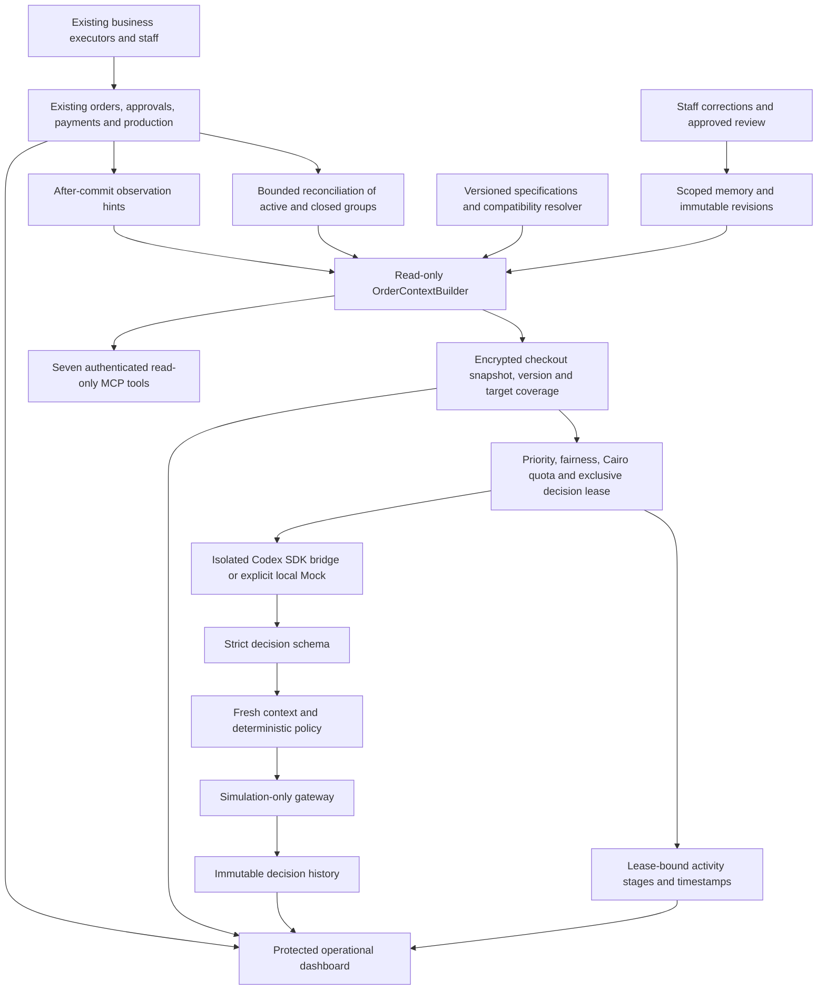

# HeroKid Auto Pilot — Shadow foundation

This branch prepares one checkout-level operational view and one decision agent.
It does not replace ProcessRuntime, confirmations, payment review, product
automation, the Codex scene worker, Studio, or employee ownership.

There is deliberately no arrow from the gateway to business executors. PHP has
no decision-agent CLI launcher. The isolated bridge receives only sanitized facts
through a private Unix socket. The model cannot access MCP, filesystem tools,
app secrets, queues, SQL, arbitrary HTTP or shell. See the runtime README and
implementation evidence for tested guarantees and real-authentication limits.

## Existing architecture and reuse

| Current owner | Reuse and boundary |
|---|---|
| ProcessRuntime / ProcessDefinition / ProcessLivePolicy | Remain the workflow engine, admission authority, response history and immutable workflow owner. No historical enrollment or replay. |
| ProcessIdentityService | Read recorded attempt/approval facts only. Its `ready`/polling paths may mutate state and are never called by context/MCP. |
| ProcessPaymentReview | Read existing pending-review and ledger signals. Screenshots/messages cannot turn into paid amounts. |
| OrderConfirmationService / poller | Read event status and the existing `canSend` predicate; never send or synchronize from an observation. |
| AutomationAssignment / AutomationHandoff | Preserve assignee, automated owner and holds. Human tasks are projections, not assignments. |
| ManualSceneService / current scene worker | Preserve approved identity, actual positive recorded payment, prior-attempt exclusion, active work and uncertain pool. New decision queue is separate. |
| PuzzleAutomation / PuzzleInputs | Existing puzzle/mug and book executors stay authoritative. Avoid media downloads, provider pricing or credential loading in the observer; paid/provider preflight is explicitly deferred. |
| ProcessProductReview / BookPageService | Read latest immutable manifest, cover/preview correlation, revocation, run state and interior fingerprint. Fresh media checks and full linked-story capture still belong to existing executor preflight. |
| ProductProductionPrompt / ProductProductionStage | Preserve purchased variants/components and unit keys. Hash and discard raw prompt/photo inputs. An explicit spec may restrict capabilities, never expand an executor. |
| AdminOrderGroupService | Reuse grouping and base active scope. AutoPilotOrderScope additionally treats delivered/cancelled orders as terminal for Auto Pilot, as explicitly confirmed by the owner. Existing workflows and holds are unchanged. Mixed checkouts retain their open siblings. |

The original baseline was `683389a`. During implementation, production advanced
to `77ef1cc` (cover artwork and preview-state synchronization). That release was
inspected and merged locally, and final checks include it. This is no assertion
that production will remain at that SHA; revalidate before any future release.
On November 3, AWS was read-only verified at `c9e685e7fd97dd4f4da83cd774d2d78ce8db10c5`.
This extension starts from the prepared feature commit `63818e5`; intervening
production releases still need reconciliation before a separately approved release.

## Lifecycle, coverage and safety

1. Saved/deleted model hooks mark checkout keys dirty after commit; observation
   failure cannot fail the source business transaction. Periodic cursor scans
   cover missed direct-SQL writes and catalogue/config changes.
2. A meaningful fingerprint change advances the version and invalidates coverage.
   Registry version is part of the fingerprint; bump it for changed policy/prompt
   semantics. Active scene progress refreshes operational facts without burning AI calls.
3. One provider call selects one remaining target. The same full checkout facts
   accompany each bounded cycle. Proposals never become hypothetical executed
   effects; dependent stages keep waiting while independent siblings are covered.
4. Default maximum is three cycles/pass and 100 attempts/Cairo day, configurable.
   Changed/blocked work is prioritized, with every third pass admitting oldest
   attempted/never-evaluated work. Large checkouts yield between passes.
5. Fresh context is read after the provider reply, then audit/coverage is committed
   under a state lock with a second version/fingerprint check. Stale proposals
   cannot cover the new version. The future executor needs another transaction-
   scoped business preflight; this simulation does not claim execution-grade
   database snapshot consistency or byte-level media validation.
6. Invalid, unsupported, quota-deferred, unavailable and uncertain cases remain
   visible. No blind provider retry, no generation retry, no lease clearing in
   existing production systems. Only shadow audit/lease/quota tables are written.

Confidence never overrides policy. Payment amounts, identity approval, manual
holds, successful assets, uncertain external effects, printing, packaging and
shipping remain under existing human/business authority. Customer free text is
excluded from model inputs; its keyed digest invalidates stale decisions.

## Read-only MCP contract

Official `laravel/mcp` 1.1.2 handles transport and schemas; no custom JSON-RPC
server or new workflow framework. A single common read adapter wraps the context
and registry. [Laravel's documented Sanctum integration](https://laravel.com/docs/12.x/mcp#sanctum)
fits the existing application and avoids adding an OAuth service.

Endpoint: `POST /mcp/herokid`; disabled by default with `AGENTIC_MCP_ENABLED=false`.
Required: active admin with Agent API enabled, an actual non-expired Sanctum
personal token containing **explicit** `agentic:read`, plus `orders.view` and
`order_automation.view`. Wildcard tokens do not substitute for the dedicated
scope. Foreign browser origins are refused. No OAuth registration or token
creation UI was added. The isolated Decision Agent does not connect to this MCP.

All tools accept `order_id` (positive integer), resolve the canonical checkout,
and return schema version, checkout reference, fingerprint, matching observed
context version or null, freshness, `read_only=true` and typed `data`. Extra
arguments are rejected. Full nested facts retain the versioned context contract;
there are no signed media URLs or raw transcripts. Oversized responses fail closed.

| Tool | Additional input | Data |
|---|---|---|
| get_order_context | — | Sanitized current checkout/units; no amounts |
| get_product_spec | unit_key belonging to this checkout | Resolved safe unit specification and facts |
| get_available_actions | — | Registry proposals; execution_enabled=false |
| get_production_status | — | Existing unit runs, completed/missing outputs |
| get_customer_interactions | — | Structured confirmation, replies and review approval; no raw chat |
| get_payment_status | — | Recorded payment facts and one checkout balance in cents; additionally explicit agentic:finance and orders.statistics.view |
| get_human_tasks | — | Proposed review/missing-info/exception/Studio work with existing assignee; later printing/packaging/shipping stay human |

Authorization is repeated during invocation, including for the financial tool;
discovery visibility and read-only annotations are not the security boundary.
No write tools are registered. Future write contracts must enter an authenticated
Policy Engine/Execution Gateway, never call services directly from MCP.

## Persistence and dashboard

Seven additive tables across three forward-only migrations: versioned product specs,
checkout observations, agent runs, immutable decisions, and a single runtime
control row, plus memory rules and their immutable revisions. No duplicate payment ledger, media store, business attempts or human
assignment table. Context snapshots are encrypted with the existing APP_KEY;
never rotate it as part of this feature. No raw prompts or provider transcripts
are stored in decision audit. Audit models prohibit editing/deleting decisions.

`/admin/agentic-automation` uses existing order/automation permissions. It includes
unobserved active groups, live status, coverage/freshness, errors, product/state/
decision filters and history. Activity refreshes every 5 seconds; the order table
refreshes every 30 seconds to keep aggregate-query load bounded. Both read without
an AI call. Detail pages rebuild current facts and flag stale proposals. Financial
amounts retain the separate statistics permission. Output links use existing
order-page permissions. There is no chat or activation control.

The activity panel records the actual lease holder's stage: provider readiness,
order selection, context reading, decision wait, policy checks and result saving.
It shows the current checkout and remaining/selected unit references, start/update
times, last saved proposal and provider/quota/observation state. Expired or stalled
workers are shown as uncertain, never as confirmed running. Local benchmark work
has its own activity label. Polling only reads; it cannot invoke AI or retry work.

## Editable learning memory

`/admin/agentic-automation/memory` provides global, capability and checkout-scoped
guidance. View requires `orders.view` and `order_automation.view`; save, restore,
and approved-review import also require `order_automation.manage` and CSRF protection.
Corrections can originate from a saved proposal. The linked checkout is derived
server-side; new corrections start as drafts. A manager explicitly chooses active
or archived. This is persistent guidance, not model training or self-editing code.

Each edit records the actor, reason and immutable numbered snapshot. Optimistic
revision checks prevent stale editors overwriting newer changes; restore creates a
new revision. Guidance, snapshots and change reasons are encrypted. Approved owner
rules import idempotently and never overwrite staff edits. Import is an explicit
admin action or local/testing command, not a GET side effect or production seeder.

Only active rules matching the current checkout/capabilities enter the context.
The default bound is 30 matching rules, configurable up to 100; overflow blocks the
AI call visibly instead of silently omitting rules. Rule/version digests invalidate
applicable coverage; dirty hints for unrelated checkouts do not spend new decisions.
Each run freezes the exact rule revisions used. A correction during evaluation
invalidates stale results. Text cannot authorize tools, supply payment/approval
facts or bypass deterministic safety and ownership checks. There is no memory-write
tool for the Decision Agent. Staff must keep guidance free of personal data;
validation blocks common contacts, links and key formats, not all possible PII.

## Evaluation and release gates

- 37 anonymized actual checkouts, captured read-only on 2 November. The owner's
  November 3 review and clarification are incorporated in v2: 87 targets, six
  changed cases, no rewritten order facts. The original 89-target v1 is retained.
  20 synthetic edge cases / 25 targets are reported separately.
- The actual v2 corpus is owner-approved; see the versioned owner-review record.
- Mock scores test pipeline/contract/coverage consistency. They are **not** Codex
  correctness. Real subscription inference has not been run or proved available.
- Harness reports correctness, unsafe proposals before policy, false waits,
  unsupported and unevaluated targets, and comparable existing-admission outcomes.
  Existing-story comparison excludes media/dispatch and the sampled comparable
  stories are currently not admission candidates; do not generalize that parity.
- Real benchmark calls require an approved corpus, verified isolated ChatGPT auth,
  local/testing environment, explicit evaluation flag and a new report destination.
  They share the operational quota/lease and never fall back to a Mock/API key.
- Future live execution requires ≥95% correctness on the approved corpus and
  zero unresolved safety-critical failures, plus separately approved execution
  implementation, acceptance, deployment, rollout and recovery checks. A green
  benchmark never changes `live_execution_gate=false` in Phase 1.

## Future deployment and rollback proposal — not executed

Revalidate AWS SHA and exact diff; preserve concurrent releases and record a
private recovery checkpoint. Review the three additive migrations before seeking
explicit production-migration approval. Install the reviewed Composer lockfile,
discover packages, preserve all old committed hashed assets and verify the new
manifest. Keep all three AGENTIC switches off during code deployment. Do not
restart current production workers for this feature or run blanket deploy.sh.

Observation-only enablement can be reviewed first, with bounded load/freshness
measurements. Evaluation then requires a separately reviewed runtime container,
dedicated subscription login and a dedicated worker for `agentic-shadow`. Never
mount app code/secrets into the runtime or add paid AWS services automatically.
The runtime needs explicit egress for official subscription inference; local
network-none acceptance is not proof of a deployed network/auth configuration.

Rollback is flags off, gracefully drain only the dedicated shadow worker/runtime,
restore reviewed code/assets, and retain all seven audit/spec/memory tables. No data
rollback, production queue clearing, historical retry, Hostinger change or audit
table drop. Existing executors continue as before.

The next execution phase should start with internal proposed human tasks, then a
small explicitly approved capability using existing services and receipts. Paid
generation/customer messaging need separate scoped rollout, fresh preflight,
idempotent reservation/outbox, operation IDs and unknown-result reconciliation.
Automatic financial approval, identity approval, printing and shipping remain
outside the decision agent's authority.
