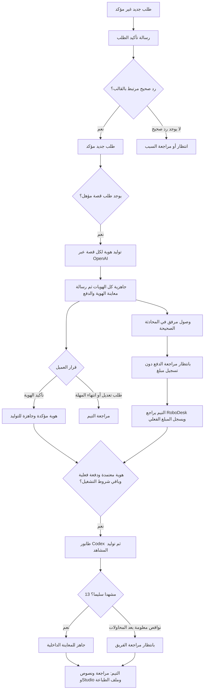

# مرجع أوتوميشن HeroKid — التشغيل الحالي والتفاصيل الفنية

**تاريخ المراجعة:** 2 نوفمبر 2026، الساعة 13:14 بتوقيت القاهرة / 11:14 UTC.  
**نسخة التطبيق التي تم التحقق منها على AWS:** `01e6f6f684d00cca57496e66ca13323fbf2e1286`.  
**النطاق:** تطوير الأوتوميشن في الفترة من 31 أكتوبر إلى 2 نوفمبر: تأكيد الطلب، هوية الطفل، مراجعة الدفع، توليد مشاهد القصص، البازل والمج، إعادة التوليد، مسؤولية الطلب، المتابعة وسجل النشاط. يشمل أيضًا ما تم تجهيزه ولم يُنشر بعد.

**تحديث 2 نوفمبر، 14:32 القاهرة:** نُشرت تجهيزات أدوار الكفر/الصفحات وعدد الصفحات ومتغير `{{preview_links}}` اليدوي بالإصدار `48c2e4e`. الأقسام أدناه تصف لقطة 13:14 السابقة؛ مسار التوليد الآلي للكتاب والمعاينة الموحدة لم يُنشر بعد.

هذا الملف يصف السلوك الموجود في الكود المنشور والإعدادات المقروءة من الإنتاج، وليس مجرد تصور للمطلوب. الأرقام التشغيلية أدناه لقطة مؤرخة وليست عدادات حية. لم تُرسل رسائل أو تُولّد صور أو تُسجل دفعات أو تُعاد محاولات إنتاج أثناء إعداد الملف.

## فهرس

1. [الوضع الحالي باختصار](#1-الوضع-الحالي-باختصار)
2. [الوحدات الأساسية والربط بين الطلبات](#2-الوحدات-الأساسية-والربط-بين-الطلبات)
3. [خريطة مسار القصة](#3-خريطة-مسار-القصة)
4. [إنشاء الطلب وتأكيده](#4-إنشاء-الطلب-وتأكيده)
5. [تكامل RoboDesk وإرسال القوالب](#5-تكامل-robodesk-وإرسال-القوالب)
6. [قراءة رد العميل وربطه بالطلب](#6-قراءة-رد-العميل-وربطه-بالطلب)
7. [توليد هويات القصص](#7-توليد-هويات-القصص)
8. [معاينة الهوية والاعتماد والتعديل](#8-معاينة-الهوية-والاعتماد-والتعديل)
9. [مراجعة الدفع وتسجيله](#9-مراجعة-الدفع-وتسجيله)
10. [أهلية توليد المشاهد](#10-أهلية-توليد-المشاهد)
11. [تنفيذ Codex وربط الصور وحفظها](#11-تنفيذ-codex-وربط-الصور-وحفظها)
12. [فشل المشاهد والمحاولات والاستكمال](#12-فشل-المشاهد-والمحاولات-والاستكمال)
13. [الوقت والمتوسطات والتحميل](#13-الوقت-والمتوسطات-والتحميل)
14. [أوتوميشن البازل والمج](#14-أوتوميشن-البازل-والمج)
15. [إعادة توليد منتج بعد تعديله](#15-إعادة-توليد-منتج-بعد-تعديله)
16. [مسؤولية Automation وتدخل التيم](#16-مسؤولية-automation-وتدخل-التيم)
17. [حالات الإرسال والتسليم وإعادة الإرسال](#17-حالات-الإرسال-والتسليم-وإعادة-الإرسال)
18. [سجل النشاط](#18-سجل-النشاط)
19. [منشئ المسارات وما يدعمه](#19-منشئ-المسارات-وما-يدعمه)
20. [معاينات المنتجات ومشاهد القصة](#20-معاينات-المنتجات-ومشاهد-القصة)
21. [كتاب التلوين والمعاينة الموحدة](#21-كتاب-التلوين-والمعاينة-الموحدة)
22. [الشحن والـPickup](#22-الشحن-والـpickup)
23. [إعدادات التشغيل والعمال والتخزين](#23-إعدادات-التشغيل-والعمال-والتخزين)
24. [لقطة الإنتاج والملاحظات المفتوحة](#24-لقطة-الإنتاج-والملاحظات-المفتوحة)
25. [دليل التيم للحالات اليومية](#25-دليل-التيم-للحالات-اليومية)
26. [حدود التنفيذ والاختبار والاستعادة](#26-حدود-التنفيذ-والاختبار-والاستعادة)
27. [خريطة الكود والجداول والمراجع](#27-خريطة-الكود-والجداول-والمراجع)

---

## 1. الوضع الحالي باختصار

| الجزء | الحالة الحالية | نقطة انتهاء الأوتوميشن |
|---|---|---|
| تأكيد الطلب الجديد على واتساب | منشور ومفعّل | رد العميل الصحيح يحوّل الطلب إلى `new_confirmed` |
| توليد هوية القصص | منشور ومفعّل | هوية مستقلة لكل طلب قصة ثم معاينة مجمعة لهويات عملية الشراء |
| اعتماد الهوية | منشور ومفعّل | اعتماد الهويات المحددة وتغيير حالة القصص إلى هوية مؤكدة وجاهزة للتوليد |
| تنبيه مراجعة الدفع | منشور ومفعّل | رصد مرفق مرتبط بالمحادثة وفتح مراجعة بشرية؛ لا يُسجل مبلغ تلقائيًا |
| تسجيل مبلغ الدفع | يدوي بواسطة التيم | تسجيل المبلغ الحقيقي في سجل المدفوعات |
| مشاهد القصة عبر Codex | منشور ومفعّل تلقائيًا ويدويًا | 13 مشهدًا سليمة: جاهز للمعاينة؛ نقص بعد المحاولات: بانتظار مراجعة الفريق |
| توليد البازل | منشور ومفعّل | صورة واحدة لكل بند إنتاج، محفوظة في المرفقات والمعاينة |
| توليد المج | منشور ومفعّل للمنتج المدعوم | نفس مسار الصورة الواحدة، ببرومبت المج نفسه |
| إعادة توليد منتج محدد | منشور | زر يدوي ينشئ محاولة جديدة بالبيانات الحالية ويحتفظ بالصور السابقة |
| رسالة معاينة المنتجات تلقائيًا | غير مكتملة/غير مفعّلة في هذا المسار | التيم يستخدم المعاينة والإرسال اليدوي الحاليين |
| كتاب التلوين: كفر ثم صفحات | تصميم وجزء من التجهيزات المحلية؛ غير منشور كمسار كامل | يحتاج استكمال التنفيذ وربط المعاينة والدفع وصفحات Codex |
| رسالة واحدة تجمع الهوية والمنتجات بعد جاهزية الجميع | قرار معتمد، التنفيذ الكامل غير منشور | لا تُنسب هذه الوظيفة إلى المسار الحالي |
| إضافة النصوص وتجهيز PDF الطباعة في Studio | يدوي حاليًا | التيم يراجع ويضيف النصوص ويصدر ملف الطباعة |

**تنبيه وقت المراجعة:** تفعيل Codex لا يعني أن القصص المنتظرة تبدأ الآن؛ محاولتان بنتيجة غير مؤكدة وحجز نشط تمنعان بدءها وفق حماية النظام. التفاصيل والأعداد في [القسم 24](#24-لقطة-الإنتاج-والملاحظات-المفتوحة).

**قاعدة مهمة:** تأكيد الهوية ≠ وصول مرفق ≠ تسجيل دفعة. الثلاثة أحداث مستقلة، ولا يُعتبر رد الـAI أو صورة التحويل وحدهما إثباتًا لوصول المال.

## 2. الوحدات الأساسية والربط بين الطلبات

عملية الشراء التي تظهر للعميل برقم مثل `HK11-…` قد تحتوي على أكثر من سجل داخلي في `orders`: قصص متعددة ومنتجات، وقد تخص أكثر من طفل. الربط بينها يتم بـ`checkout_group_key`، مع مرجع شراء ظاهر للعميل.

- **عملية الشراء / Checkout:** وحدة رسالة التأكيد الأولى، وكثير من ضوابط المسؤولية والدفع.
- **طلب القصة:** له الطفل والقصة والهوية المعتمدة وبرومبت المشاهد ونتائجه الخاصة.
- **بند المنتج / OrderItem:** له المنتج والنسخة المشتراة والتخصيصات وملاحظاته ووحدة الإنتاج.
- **وحدة الإنتاج:** مفتاح ثابت يربط الصورة بالشيء الصحيح؛ في مشاهد القصص مثلًا `story:<order_id>`، وفي المنتجات يُستخدم `unit_key` الذي ينتجه بناء وحدات المنتج المحدد.
- **المسار / Workflow:** تعريف الشروط والخطوات والفروع.
- **نسخة المسار / Revision:** نسخة منشورة ثابتة؛ كل تشغيل يحتفظ بالنسخة التي بدأ عليها.
- **التشغيل / Run:** تنفيذ المسار على عملية شراء، أو تنفيذ مشاهد قصة، أو محاولة صورة منتج، ولكل نوع سجله.

المسؤولية قد تظهر **Automation على مستوى عملية الشراء كلها** طالما أحد أجزائها تحت التنفيذ. اكتمال قصة واحدة لا يعني بالضرورة أن كل إخوتها انتهوا.

في تجربة 3 قصص لطفلتين، النظام ولّد **3 هويات مرتبطة بالقصص**؛ ليس هناك دمج تلقائي لهويات القصص اعتمادًا على تشابه اسم الطفل فقط.

## 3. خريطة مسار القصة



ترتيب الدفع والاعتماد قد يختلف: يمكن تسجيل دفعة قبل اعتماد الهوية، أو اعتماد الهوية أولًا. مشاهد القصة لا تبدأ تلقائيًا إلا بعد اجتماع الشروط. أما الصور المطلوبة من OpenAI لهوية القصة أو للبازل/المج فتبدأ بعد التأكيد وفق شروط مسارها، دون اشتراط دفعة مسبقة في المرحلة الحالية.

**الفرق بين حالة الطلب وحالة التشغيل:** عبارة «جاري توليد الهوية» قد تكون حالة تشغيل `waiting_identity`، وليست بالضرورة تغييرًا لحقل حالة الطلب. تعريف المسار المفعّل لا يضيف انتقالًا مستقلًا إلى `under_review` أثناء التوليد؛ لذلك لا يُفترض أن كل خطوة تغيّر كارت حالة الطلب. الانتقال المؤكد عند اعتماد الهوية هو `costomer_confirmed`، وعند إدراج المشاهد `generating`.

## 4. إنشاء الطلب وتأكيده

### 4.1 التسجيل

1. يُحفظ طلب الشراء وأجزاؤه أولًا.
2. الطلب الجديد يبدأ بحالة **طلب جديد غير مؤكد**، ومفتاحها `new`؛ تم تغيير الاسم المعروض مع الحفاظ على المفتاح المستخدم في الكود.
3. تُسجل أحداث عملية الشراء والحالة في قاعدة البيانات، ثم تُرسل المهام بعد نجاح المعاملة.
4. إنشاء الويب والموبايل والإدارة المغطى في الكود يصدر الأحداث المناسبة بعد اكتمال الحفظ. محاولة دفع إلكتروني لم تكتمل ليست طلب COD مكتملًا مؤهلًا لمجرد وجود صف مؤقت.
5. يُنشأ سجل إرسال فريد لتأكيد عملية الشراء، حتى لا تتكرر الرسالة لكل طفل أو قصة داخل نفس العملية.

### 4.2 نطاق التشغيل

- تأكيد الطلب مفعّل للجمهور `all_new` بعد الحد المسجل `after_order_id=2683`.
- هذا **حد تشغيل تقني** وليس الرقم التجاري الظاهر للطلب.
- لا يتم إعادة إرسال تأكيد لكل الطلبات القديمة عند نشر نسخة جديدة.
- إضافة منتج إلى عملية قديمة لا تعني أنها عملية شراء جديدة تستحق رسالة تأكيد أولى ثانية.
- الكتابة المباشرة بـSQL أو بعض مسارات `saveQuietly` لا تصدر أحداث الحالة تلقائيًا؛ أي مدخل جديد للطلبات يجب ربطه بالأحداث صراحةً.

### 4.3 القالب

القالب الفعلي: `herokid_order_confirmation`.

| موضع المتغير | القيمة |
|---|---|
| 1 | اسم العميل |
| 2 | رقم عملية الشراء الظاهر |
| 3 | تفاصيل القصص والمنتجات |
| 4 | القيمة الإجمالية بعد الخصم وشاملة الشحن، رقم فقط |

زر **«تأكيد الطلب»** Quick Reply. القالب يحتوي بالفعل على وصف العملة والشحن، فلا يضاف الوصف مرة ثانية داخل القيمة الرقمية.

## 5. تكامل RoboDesk وإرسال القوالب

### 5.1 الربط الفعلي

تأكيدات الطلب والهوية تستخدم مسارات المحادثات العامة في Tenant هيروكيد:

- `GET https://hero-kid.robodesk.ai/api/conversation/messagesByPhone`
- `POST https://hero-kid.robodesk.ai/api/conversation/close`
- `POST https://hero-kid.robodesk.ai/api/conversation/start/sendMsg`

لا يعتمد المسار على Callback من RoboDesk إلى HeroKid. ولا يستخدم المسار الافتراضي القديم `/api/integrations/herokid/v1/events`؛ وجوده في ملف إعدادات قديم لا يعني أنه Endpoint عامل في RoboDesk.

كذلك `ROBODESK_ENABLED=false` في الإعداد العام القديم **لا يعني توقف تأكيدات واتساب**: التأكيد له مفتاح تفعيل مستقل، وحساب المحادثات المشفر وإعداداته الخاصة.

### 5.2 قبل كل إرسال

1. قراءة المحادثات الخاصة برقم العميل بعد توحيد صيغة الرقم.
2. استخراج `id` لكل محادثة مفتوحة `closed=false`.
3. إغلاق المحادثة المفتوحة، حتى لو كانت مع AI أو موظف، طبقًا لقرار صاحب المشروع.
4. جسم الإغلاق يتضمن:

```json
{
  "closeData": {
    "conversations": [{"_id": "<interaction-id>"}],
    "isBulk": true,
    "status": "completed",
    "statusType": "completed"
  },
  "note": null
}
```

5. لا يستكمل الإرسال قبل نجاح الإغلاق أو إعادة القراءة التي تثبت عدم وجود محادثة مفتوحة.
6. يُرسل القالب باللغة `ar-EG`. لغة Meta هي `ar`، لكن RoboDesk يتوقع `ar-EG`.
7. لا يُرسل `procedureId`؛ لأن وجوده قد يعيد استجابة قبل تنفيذ الإرسال ومن غير معرف الرسالة.

### 5.3 استجابة الإرسال والأخطاء

- بعد قبول Meta للإرسال، يعيد RoboDesk `_id` للمحادثة و`channelId` الذي يحمل `wamid` للقالب.
- يُحفظ المعرفان للربط اللاحق. لا تُخزن كل وثيقة المحادثة في سجل الإرسال.
- **فشل الإغلاق:** إعادة قراءة ثم إعادة إغلاق واحدة كحد أقصى؛ الإغلاق نفسه لا يرسل رسالة.
- **501 بالنص الدقيق `Customer already have another interaction`:** نتيجة موثقة بأنه لم تُرسل رسالة؛ يُعاد تسلسل القراءة/الإغلاق/الإرسال مرة واحدة فقط.
- **409:** القالب معطل، ويُسجل كسبب واضح لعدم الإرسال.
- **Timeout أو خطأ آخر أو استجابة بلا معرفات صحيحة:** النتيجة غير مؤكدة؛ لا تُرسل الرسالة مرة أخرى تلقائيًا.
- RoboDesk لا يوفر Idempotency للإرسال، ولذلك لا يصلح اعتبار «لا أرى رسالة» دليلًا كافيًا لإعادة إرسال آمنة.

قفل رقم التواصل وحجز المحاولة قبل الاتصال يحميان من الإرسال المتزامن. إعادة SQL عند deadlock لا تعني إعادة استدعاء مزود الرسائل.

## 6. قراءة رد العميل وربطه بالطلب

### 6.1 طريقة القراءة

- HeroKid هو الذي يقرأ RoboDesk دوريًا.
- أثناء انتظار التأكيد/الهوية/مراجعة الدفع، تُستخدم قراءة كاملة ضمن أحدث **50 محادثة**، **بدون `after`**.
- السبب: رسالة عميل قد تصل متأخرة بينما تاريخها من Meta أقدم من آخر cursor؛ القراءة بـ`after` قد تفقدها.
- `limit=50` يحد عدد المحادثات، وليس عدد الرسائل داخلها.
- هذه نافذة حديثة، وليست ضمانًا لإرجاع التاريخ كله بلا حدود.
- يتكرر الفحص عادةً بعد حد أدنى 600 ثانية، بالإضافة إلى وقت الفحص والطابور؛ الاستجابة ليست Callback لحظيًا.
- التكرار في القراءة لا يكرر القرار؛ يتم حفظ معرف الرسالة المستهلكة ومنع استهلاكها مرتين.

### 6.2 قواعد التأكيد

لا يُقبل إلا رد وارد `direction="in"` بالنص المطلوب بعد إزالة المسافات من طرفيه.

1. إذا كان `replyTo` يطابق `wamid` قالب أرسله النظام وحفظه، يُربط الرد بذلك القالب.
2. الربط الدقيق بالقالب يمكن أن يعمل حتى لو جاء الرد في محادثة أخرى، مع باقي فحوص الرقم والسياق.
3. إذا كان `replyTo` فارغًا، أو يشير إلى رسالة ليست أحد القوالب المعروفة، يُعامل كرد مكتوب ويُبحث عن **أحدث قالب صحيح سبق الرد داخل نفس `interactionId`**.
4. كتابة «تأكيد الطلب» يدويًا تُقبل مثل الضغط إذا نجح الربط.
5. رسالة الـAI الصادرة، حتى لو قالت «تم التأكيد»، ليست تأكيد العميل ولا تغير الطلب.
6. اختلاف رقم العميل أو غموض قالبين/طلبين أو اختلاف دليل المحادثة يمنع التغيير التلقائي.
7. توقيت Meta الوارد دقته ثانية، والصادر دقته مللي ثانية؛ حالات نفس الثانية الغامضة لا يُفترض ترتيبها.

نتيجة التأكيد الصحيح للطلب: تغيير الحالة من `new` إلى **`new_confirmed` / طلب جديد مؤكد**، مع تسجيل الحدث والنشاط وعدم تكرار العملية.

## 7. توليد هويات القصص

### 7.1 المسار المنشور

المسار المفعّل وقت المراجعة:

- الرقم الداخلي: **8**.
- الاسم: **توليد الهوية ومراجعة الدفع**.
- نسخة التعريف: **1**.
- النطاق: عملية الشراء `checkout`.
- الحدث: `status_entered`.
- الشرط: طلبات تحتوي قصصًا وحالتها `new_confirmed`.
- قائمة القصص فارغة: معناها كل القصص المطابقة، لا قصة واحدة محددة.
- حد أحداث المسار: `process_after_event_id=10`؛ لا يُعاد تشغيل ما قبله بمجرد التفعيل.
- وضع التشغيل عام `all_new`، وحد الطلبات للمسار `0`؛ لا يلغي ذلك حد الأحداث أو منع تكرار التشغيل.

تم إدخال مجموعة من الطلبات القديمة المؤكدة بإذن منفصل سابقًا. هذه واقعة تشغيل محددة وليست سياسة backfill تلقائي عند كل نشر.

### 7.2 ما يحدث عند توليد الهوية

1. فحص كل سجلات عملية الشراء والقصص المطلوبة، وعدم إخفاء قصة شقيقة من رسالة الاعتماد.
2. تثبيت نسخة بيانات تشمل القصة والطفل والبرومبت وصور المراجع وبصماتها.
3. استخدام برومبت الهوية الموجود فعلًا في HeroKid، لا إنشاء وصف مستقل غير مرتبط بالطلب.
4. استخدام ما يصل إلى 3 صور مرجعية موثقة ضمن هذا المسار.
5. إنشاء مهمة هوية مستقلة لكل طلب قصة وربطها بسجل الهوية ومحاولة التوليد الأساسية.
6. استخدام OpenAI API وفق إعداد الهوية؛ وقت المراجعة: `gpt-image-2`، مقاس `1536x1024`، جودة `medium`.
7. التحقق من الإعدادات والصلاحيات وتقدير التكلفة قبل الطلب الخارجي.
8. حفظ النتيجة الخاصة مع checksum ومرجع المحاولة وبيانات الاستخدام/التكلفة المتاحة، وربطها بالقصة الصحيحة.
9. لا تُرسل رسالة المعاينة إلا بعد جاهزية هويات القصص المطلوبة كلها.

السقف المضبوط حاليًا **1 USD لتقدير هويات عملية الشراء** في إعداد النظام وتعريف المسار. هذا فحص تقديري قبل التنفيذ، وليس ضمانًا لسعر المزود أو سقف فاتورة قاطعًا.

لا يعاد تلقائيًا طلب توليد هوية نتيجته غير مؤكدة. الصورة التي تصل متأخرة أو بعد تغيّر البيانات تُحتفظ بأدلتها للمراجعة ولا يعتمدها المسار بصمت. الهوية الموجودة مسبقًا أو محاولة أخرى متعارضة قد تمنع بدء توليد جديد؛ لا يفترض النظام أن حذف سجل يحل المشكلة.

## 8. معاينة الهوية والاعتماد والتعديل

### 8.1 القالب المنشور

`herokid_identity_review_payment`، باللغة `ar-EG` عند إرساله إلى RoboDesk.

| الموضع | القيمة |
|---|---|
| 1 | `customer_name` اسم العميل |
| 2 | `order_reference` رقم الشراء |
| 3 | `story_names` أسماء القصص |
| 4 | `child_names` أسماء الأطفال |
| 5 | `product_names` المنتجات المصاحبة أو النص البديل المناسب |
| 6 | `identity_preview_url` رابط معاينة الهويات الخاصة بهذا التشغيل |
| 7 | `order_total` إجمالي الطلب رقمًا |
| 8 | `remaining_amount` المتبقي الحقيقي بعد الدفعات المسجلة، رقمًا |

ذكر أسماء المنتجات في الرسالة **لا يعني أن صور المنتجات داخلة في رابط الهويات الحالي**. تجميع الجميع في اعتماد واحد ما زال مسارًا منفصلًا غير منشور.

### 8.2 المعاينة والقرار

- صفحة خاصة برابط موقع ومؤقت، تعرض هويات القصص المرتبطة بالتشغيل وتوضح أن التأكيد يشمل المعروض كله.
- صلاحية رابط الصفحة في التنفيذ الحالي 35 يومًا؛ روابط الصور قصيرة الأجل حتى 15 دقيقة وبحد صلاحية الصفحة.
- فحوص الربط والسياق والبصمة تمنع عرض نسخة غير صالحة بعد تغييرات مؤثرة.
- امتلاك الرابط يمنح الوصول أثناء صلاحيته؛ لا يُنشر في تقارير أو سجلات عامة.
- الزران: **«تأكيد الهوية»** و**«طلب تعديل الهوية»**.
- نافذة انتظار الرد في المسار الحالي: **48 ساعة**.

**عند تأكيد الهوية:** تُعتمد محاولات الهوية المحددة لهذا التشغيل، وتتغير حالة القصص إلى **هوية مؤكدة وجاهزة للتوليد**؛ المفتاح التاريخي في الكود `costomer_confirmed` بهذا الإملاء. يحدث ذلك مستقلًا عن تسجيل المال.

**عند طلب تعديل أو انتهاء المهلة:** يذهب التشغيل لمراجعة التيم. لا يُفهم ذلك كتأكيد، ولا يُعاد توليد الهوية تلقائيًا في حلقة.

تعليمات AI في RoboDesk سبق تعديلها لفهم تأكيد الهوية وطلب تعديلها، وعدم الادعاء باعتماد الدفع. هذا الملف يتحقق من جانب HeroKid؛ لم يُعد اختبار الـAI أو قراءة نسخة تعليماته مباشرة أثناء هذه المراجعة. قرار HeroKid يعتمد على الرسالة الواردة وربطها، وليس على صياغة رد الـAI.

## 9. مراجعة الدفع وتسجيله

### 9.1 إشارة تحتاج مراجعة

بعد إرسال قالب معاينة الهوية الصحيح، أي رسالة واردة **بمرفقات غير فارغة** في نفس المحادثة الصحيحة، وبتوقيت لاحق مثبت، تُعامل كإشارة مراجعة.

- لا يوجد اشتراط لتصنيف AI من نوع `payment_receipt`؛ الاقتراح السابق لهذا التصنيف لم يُستخدم.
- لا يتم الاعتماد على جملة «وصلني إثبات التحويل» لفتح المراجعة.
- لا ينسخ مسار مراجعة الدفع صورة الإيصال إلى مرفقات الطلب ولا يستخرج منها مبلغًا.
- تُحفظ معرفات الرسائل المرتبطة بالإشارة، مع منع التكرار.
- الصورة قد تكون إيصالًا، أو طلب تعديل، أو شيئًا آخر؛ القرار المالي بشري.
- أي مرفق غير مربوط بثقة لا يُلصق عشوائيًا بطلب آخر لنفس الرقم.

### 9.2 حالة الدفع

إذا كانت كل سجلات الشراء بلا مبلغ مدفوع وحالاتها `unpaid` أو `pending_review`، تتحول إلى:

**`pending_review` — بانتظار مراجعة الدفع**.

المبلغ المدفوع يظل صفرًا. يسجل سجل الدفع انتقال الحالة بصفر، ولا يحتسبه تحصيلًا. لو فيه دفعة سابقة بالفعل، تظل الحالة المالية والمبالغ محفوظة ويظهر تنبيه المراجعة دون تحويل المدفوع جزئيًا إلى غير مدفوع.

### 9.3 دور الفريق

1. فتح تنبيه مراجعة الدفع في الطلب.
2. فتح RoboDesk ومراجعة رسالة العميل والمرفق والتحقق بالطريقة المعتمدة لدى الفريق.
3. تسجيل **المبلغ الفعلي** يدويًا في HeroKid، لا المبلغ المكتوب في رسالة طلب الدفع بالضرورة.
4. إنهاء مراجعة المرفقات من الإجراء المخصص، مع الملاحظة والتأكيد والصلاحية.

إغلاق المراجعة ليس تسجيل دفعة. إذا أُغلقت المراجعة بلا دفعة، يعود `pending_review` إلى `unpaid` وفق شروطه. بعد إغلاق مراجعة هذا التشغيل تتوقف متابعة مرفقاته لهذا الغرض؛ القراءة العادية للمحادثات قد تستمر لوظائف أخرى.

قراءة الدفع تستمر بعد `waiting_staff` ما دامت المراجعة مؤهلة ومفتوحة؛ لا تتوقف لمجرد اعتماد الهوية. ومع ذلك، الاستلام اليدوي الذي يضع Hold يوقف متابعة هذا التشغيل حتى إرجاعه وفق الضوابط.

**قاعدة أهلية المشاهد:** أي مبلغ موجب مسجل فعليًا يكفي، ولا يشترط 50%. نسبة 50% هي صياغة طلب المقدم للعميل، لا شرطًا برمجيًا لتوليد المشاهد.

## 10. أهلية توليد المشاهد

التسجيل التلقائي في Codex يحتاج اجتماع الشروط التالية:

- تشغيل Codex والتسجيل التلقائي مفعّلان، وصحة عامل Codex تشير إلى اتصال المصادقة.
- السجل طلب قصة، غير محذوف، وحالته `costomer_confirmed` أو `new_confirmed`.
- هوية معتمدة فعلًا، ومحاولة ناجحة لها صورة وبصمة محفوظتان؛ مجرد اختيار اسم الحالة لا يعوض الهوية.
- مبلغ موجب في عملية الشراء، مع حالة مدفوع جزئيًا أو كليًا أو مدفوع دون الشحن: `partially_paid` أو `paid_in_full` أو `paid_without_shipping`.
- عدم وجود Hold يدوي للتسجيل التلقائي.
- عدم وجود مسار متعارض يملك الطلب.
- اكتمال نصوص **13 مشهدًا**.
- عدم وجود تشغيل Codex سابق لهذا الطلب في التسجيل التلقائي، حتى لو انتهى بإيقاف أو فشل؛ هذا يمنع حلقة إعادة قصة كاملة.

التحقق المالي حاليًا على مستوى عملية الشراء: دفعة موجبة في أحد سجلات المجموعة قد تؤهل قصص المجموعة بعد باقي الشروط؛ لا يوجد توزيع آلي للمقدم على كل قصة كشرط مستقل.

يوجد أيضًا زر تشغيل يدوي للمشاهد. يمكن استعماله بعد استلام الطلب يدويًا واعتماد هويته وتسجيل مبلغ، مع عدم وجود تشغيل متعارض. يظل مسار الهوية السابق متوقفًا يدويًا؛ الضغط على الزر ليس إعادة تشغيل عامة لكل مسارات الطلب.

## 11. تنفيذ Codex وربط الصور وحفظها

### 11.1 الطابور

- الفحص والإدراج والجمع يعمل كل دقيقة.
- أقصى عدد حجوزات طابور نشطة في التنفيذ الحالي: **50 قصة**.
- أقصى توليد متزامن: **قصتان** على السيرفر الحالي.
- عند قبول القصة في الطابور تصبح حالتها `generating` / جاري التوليد (كوديكس)، حتى لو كانت تنتظر فتحة تنفيذ. شاشة التشغيل تميز الانتظار عن التوليد الفعلي.
- وجود تشغيل `uncertain` بحجز نشط يوقف **بدء** قصص جديدة لحين المراجعة؛ لا يُقتل تلقائيًا ما يعمل بالفعل.

### 11.2 فصل القصص

كل قصة لها UUID مستقل ومجلد عمل مستقل ونسخة بيانات مشفرة تشمل البرومبت ونصوص المشاهد والهوية المعتمدة وبصمتها.

عامل Codex يستقبل هوية القصة الصحيحة وبرومبتها الكامل والمشهد المطلوب، ويستخدم أقرب مشهد سابق مقبول للاتساق. كل صورة تأتي ببيانات تعريف تتضمن رقم المشهد وUUID وطلب القصة وبصمة الهوية. قبل حفظها تُقارن هذه القيم كلها.

الفصل على مستوى الملفات والمعرفات والتحقق؛ القصتان تستخدمان حساب Codex المشترك المهيأ على السيرفر، وليس اشتراكًا منفصلًا لكل قصة. حدود الخدمة أو المصادقة قد تؤثر في الأداء رغم صحة الفصل.

### 11.3 التحقق والحفظ

1. العامل يولّد الصورة في مساحة العمل الخاصة، ويكتب بياناتها وحالتها بشكل ذري قدر الإمكان.
2. HeroKid يجمع النتائج المؤكدة، وليس كل ملف وجده بالاسم فقط.
3. الصورة المطلوبة PNG، أفقية، وأقصر ضلع لا يقل عن 1024 بكسل؛ يتم طلب `1536x1024` صراحة في تعليمات التوليد.
4. تُرفض الصور غير الصالحة أو الأكبر من حد الملف أو التي تكرر نفس bytes لمشهد سابق.
5. التحقق يشمل رقم المشهد والطلب والتشغيل والهوية وSHA256 وعدم تغيّر مدخلات الطلب.
6. تُرفع الصورة إلى `s3_private` ثم تُقرأ مرة أخرى للتأكد من البصمة.
7. يُنشأ مرفق على طلب القصة نفسه بوحدة `story:<order_id>`.
8. المسار النسبي: `orders/<order_id>/codex-scenes/<run_uuid>/scene-XX.png`.
9. يتسجل نشاط حفظ كل مشهد باسم Automation.

التأكد من الأبعاد والبصمة **ليس مراجعة بصرية لوجه الطفل أو النص أو صلاحية الطباعة**؛ تظل المراجعة البشرية مطلوبة.

### 11.4 نقطة التسليم

- 13 مشهدًا سليمة محفوظة: التشغيل `completed`، والقصة `ready_preview` / جاهز للمعاينة.
- المقصود معاينة داخلية وتجهيز التيم، وليس إرسال معاينة مشاهد تلقائيًا للعميل.
- التيم يراجع الصور، يكمل أي نقص، يضع النصوص في HeroKid Studio، ويصدر ملف الطباعة.
- لا يثبت اكتمال الصور أنها طُبعت أو شُحنت، ولا يبدأ هذا المسار تلك الإجراءات.

## 12. فشل المشاهد والمحاولات والاستكمال

### 12.1 التشغيل الجديد — Protocol 4

القصص الجديدة تستخدم سجل محاولات منفصل لكل مشهد. فشل المشهد الرابع مثلًا لا يفرض ضياع 1–3 أو ترك 5–13 بلا محاولة.

| النتيجة | السياسة |
|---|---|
| صورة سليمة | حفظها وعدم توليدها مرة أخرى ضمن نفس التشغيل |
| PNG غير صالح، أبعاد غير مقبولة، حجم زائد، صورة مكررة | محاولة ثانية واحدة للمشهد، ثم الانتقال لما بعده إذا لم يصلح |
| رفض محتوى صريح من أداة التوليد | تسجيله ومراجعة بشرية، بدون إعادة صياغة تتجاوز الرفض أو إعادة تلقائية لنفس المشهد |
| لا توجد صورة، نتيجة غير صفرية من CLI، أو مهلة انتهت بنتيجة غير مؤكدة | لا يعاد نفس المشهد تلقائيًا؛ يسجل السبب، ويستكمل باقي الأرقام إذا العامل قادر على الاستمرار |
| انقطاع العامل/السيرفر أو تضارب بيانات الجمع | يحتاج تسوية، ولا يُعاد تشغيل الطلب القديم تلقائيًا |

أقصى عدد استدعاءات CLI للمشهد **اثنان**، والثاني مسموح فقط لفشل جودة محلي واضح. لا يوجد Retry تلقائي غير محدود للقصة كاملة. زمن الاستدعاء الواحد له حد 20 دقيقة في العامل الحالي، وليس وعدًا بأن كل مشهد يستغرق هذا الزمن.

تُحتفظ بالمحاولات وأسبابها والملفات المرفوضة وسجل التشخيص الخاص، ولا تُنسخ بيانات التشخيص الخام للواجهة.

### 12.2 انتهاء المرور مع مشاهد ناقصة

- التشغيل يصبح `needs_manual`.
- القصة تصبح **`pending_team_review` / بانتظار مراجعة الفريق**.
- تظهر أرقام المشاهد الناقصة والمحاولات والأسباب.
- الصور الناجحة تظل مرفقة.
- يُحرر حجز هذه القصة، ويكمل التيم **الناقص فقط**.
- قد تظل عملية الشراء باسم Automation لو قصة أخرى داخلها ما زالت تحت التنفيذ.

### 12.3 المحاولات القديمة

المحاولات القديمة من Protocol 1–3 لا تتحول بأثر رجعي إلى السياسة الجديدة. قد تبقى `quality_review` أو `uncertain` وفق عقدها السابق.

يوجد إجراء تشغيلي محدود `codex-scenes:resume-quality` للاستكمال بأدلة محفوظة: UUID جديد، تحقق من نفس الهوية والمدخلات والدفعة، وقراءة المشاهد السليمة وبصماتها قبل الاحتفاظ بها. ليس زر إعادة عامة لكل فشل، ولا يُستخدم دون مراجعة وتفويض مناسب. حالات رفض المحتوى لا تُعاد تلقائيًا؛ يمكن في الحالة القديمة الموثقة تخطي المشهد المرفوض صراحةً واستكمال ما بعده، ثم تسليم الفجوة للتيم.

إيقاف التشغيل من الواجهة يطلب التوقف وينتظر إقرار العامل. القصة المنتظرة يمكن إيقافها قبل أي استدعاء؛ الجاري لا يُعتبر متوقفًا بمجرد الضغط. الإيقاف لا يلغي استعمال الاشتراك الذي حدث بالفعل.

## 13. الوقت والمتوسطات والتحميل

### 13.1 قياس الزمن

لكل قصة يُعرض:

- وقت الانتظار والتجهيز قبل بدء العامل.
- وقت التوليد المقاس من العامل عند توفره.
- وقت البداية والنهاية، والمدة بصيغة `HH:MM:SS`.
- عند الاستكمال: مدة المحاولة الجديدة وإجمالي مدد المحاولات المعروفة دون فترات التوقف بينها.

قياس العامل يشمل تشغيل CLI والتحقق والتجهيز المحلي داخل العامل. لا يمثل وقت GPU لدى المزود، ولا يشمل انتظار الطابور قبل العامل أو كل التأخير اللاحق لجمع S3 في Laravel.

المتوسط الدقيق يُحسب من القصص المكتملة ذات القياس المعروف، مع فصل متوسط البيانات القديمة التقديري. القصص الجارية والناقصة والموقوفة لا تدخل متوسط الإكمال الناجح. لا يُخترع وقت نهاية لتشغيل انقطع ولم يُعرف انتهاؤه.

### 13.2 المتابعة الحية

- شاشة `/admin/order-automation/codex-scenes` تعرض الحالات والتقدم والأوقات والروابط والفلاتر.
- لوحة القصة داخل الطلب تتحدث كل 10 ثوانٍ عندما الصفحة ظاهرة.
- التحديث يغيّر جزء نتائج المشاهد، ويحافظ على إدخال باقي النماذج.
- عند خطأ الشبكة تبقى الصور القديمة ظاهرة ثم يعاد طلب القراءة؛ GET لا يبدأ توليدًا جديدًا.
- ظهور المشهد في الموقع قد يتأخر حتى دورة جمع النتائج التالية رغم انتهاء العامل منه.

### 13.3 تحميل الكل

زر **«تحميل الكل»** يجمع المشاهد المحفوظة لهذا التشغيل في ZIP، بأرقام الملفات الصحيحة، بعد التحقق من bytes الأصلية وبصماتها في S3. لو القصة غير مكتملة يحتوي الموجود فقط ويوضح العدد. الملف المؤقت خاص ويُحذف بعد الإرسال؛ لا يُنشأ رابط S3 عام.

## 14. أوتوميشن البازل والمج

### 14.1 المنتجات المدعومة حاليًا

- `personalized-child-adventure-hdf-puzzle`
- `personalized-child-family-photo-mug`

دعم الصورة الواحدة لا يعني أن أي منتج جديد في المتجر سيدخل تلقائيًا؛ القائمة وشروط المكونات صريحة.

### 14.2 خطوات التشغيل

1. تأكيد الطلب بالطريقة العامة أولًا.
2. حدث `new_confirmed` المؤهل أو الإرجاع اليدوي المؤهل يُقيّم بنود المنتجات.
3. كل بند له محاولة مستقلة وبياناته؛ لا يُستخدم اسم/صورة طفل من بند شقيق.
4. قراءة برومبت الإنتاج الحقيقي للمنتج ومكوناته، والنسخة المشتراة والتخصيصات وملاحظات الطلب وصور المرجع.
5. المسار الحالي يدعم مكون صورة واحدًا بكمية مكون واحدة للبند؛ الكمية المشتراة ليست أمرًا بتوليد تصميم مختلف لكل نسخة مطبوعة.
6. OpenAI API: `gpt-image-2`، `1536x1024`، جودة `high` وقت المراجعة.
7. سقف تقدير قبل التنفيذ: **0.50 USD للصورة**؛ تقدير وليس سعرًا مضمونًا.
8. فحص المرجع والبرومبت: صور متاحة وصالحة، لا متغيرات ناقصة، لا روابط موقعة داخل البرومبت البديل عن الصور المدخلة، وعدم وجود إنتاج سابق متعارض.
9. استدعاء واحد للمزود؛ النتيجة غير المؤكدة لا تتكرر تلقائيًا.
10. التحقق من الصورة ثم حفظها خاصة وإرفاقها بالطلب وإضافتها لمعاينة المنتجات.

المدخلات الحالية تسمح حتى 10 صور مرجعية، بحد 15MB للصورة وفق التحقق. المخرج المقبول في هذه الخدمة له ضوابط الحجم والمقاس والنسبة؛ صورة تحتاج مراجعة لا تُنشر في المعاينة كأنها صالحة.

المرفق وصورة المعاينة **كائنان مستقلان في التخزين** حتى لا يحذف حذف المعاينة نسخة المرفقات. المسار يستخدم قراءات تحقق بعد الحفظ.

لا يرسل هذا العامل رسالة معاينة واتساب تلقائيًا، ولا يسجل دفعة، ولا يغيّر حالة قصة في طلب مختلط. في المج الصورة ناتج تصميم يحتاج مراجعة وتجهيز مقاس الطباعة لدى الفريق، وليست ضمانًا لاكتمال layout المج النهائي.

### 14.3 القديم والمكرر

حد الأحداث التلقائي الحالي `94`. تم إدخال دفعة محددة من البازل القديم المؤكد بإذن سابق منفصل، وليس بتصفير الحد. وجود أي محاولة لنفس البند يمنع الإدراج الأولي مرة ثانية. حالات `uncertain` محفوظة للمراجعة.

## 15. إعادة توليد منتج بعد تعديله

هذه إضافة منشورة في `01e6f6f`، وتغطي حالة طلب فيه ثلاثة بازل والعميل عدّل واحدًا.

### خطوات التيم

1. يستلم الطلب يدويًا إذا كان متاحًا وتحتاج البيانات تعديلًا.
2. يعدل البند المقصود وصوره وملاحظاته ويحفظ.
3. يفتح بيانات/برومبت إنتاج هذا المنتج داخل الطلب.
4. يضغط **«إعادة التوليد»** لهذا البند وحده.
5. ينتظر ظهور المحاولة الجديدة ونتيجتها في سجل إنتاج الصور والمرفقات والمعاينة.

### الضوابط

- بيانات التوليد تؤخذ من **الحالة المحفوظة وقت الضغط**، لا من نسخة المحاولة القديمة.
- يُحفظ رقم محاولة متزايد، وربط بالمحاولة السابقة، والموظف الذي طلبها، ونسخة المدخلات الجديدة.
- الصورة السابقة لا تُمسح؛ تُضاف صورة جديدة. بالتالي قد تظهر النسختان في معرض العميل إلى أن يرتب التيم المعاينة ويزيل القديمة عند الحاجة.
- لا تُعاد صور المنتجات الأخرى ولا رسالة تأكيد الطلب.
- الضغط المتكرر على نفس النموذج، حتى بعد اكتمال نتيجته، يعيد نفس الطلب المسجل ولا ينشئ استدعاء مدفوعًا آخر.
- الضغط الجديد المتعمد من نموذج أحدث محاولة ناجحة يمكن أن ينشئ محاولة لاحقة.
- يسمح من محاولة ناجحة أو محفوظة للمراجعة أو متوقفة قبل الإرسال؛ لا يسمح من نتيجة غير مؤكدة أو أثناء التنفيذ.
- يتطلب مستخدمًا نشطًا غير Agent API، وصلاحيات تعديل الطلب ورؤية الصور وإدارة برومبت الإنتاج.
- متاح ضمن مراحل ما قبل الطباعة/الشحن المقبولة؛ لا يُستخدم لإعادة إنتاج طلب خرج للشحن بلا مراجعة حالته.
- يحمي الطلب من التعديل المتعارض خلال المحاولة، ويعيد التحكم للتيم عند النتيجة النهائية الآمنة.
- يعمل للطلب المستلم يدويًا دون إلغاء الـHold العام: الاستثناء للمحاولة المحددة فقط.
- إذا تغيّرت البيانات أو المعاينات أو سياق الاستلام بعد التسجيل، يُمنع الاستدعاء أو تُحفظ النتيجة للمراجعة دون نشرها حسب توقيت التغير.
- إعادة محاولة متوقفة بسبب بيانات قديمة تكون إجراءً يدويًا جديدًا، لا نتيجة جانبية لزر «إرجاع للأوتوميشن».

هذه الميزة تخص البازل والمج المدعومين حاليًا، وليست إعادة توليد عامة لهوية القصة أو جميع صفحات كتاب.

## 16. مسؤولية Automation وتدخل التيم

### 16.1 كيف تظهر المسؤولية

يظهر **Automation** في نفس مكان مسؤول الطلب، مع إمكانية الفلترة. لا يوجد موظف وهمي باسم Automation ولا حقل مسؤول مستقل ينافس المسؤول الأصلي. تعيين الموظف الحقيقي يظل محفوظًا، ولا تتغير نسبة الشحن للموظف لمجرد ظهور Automation.

المسؤولية تحمي من العمل المتوازي غير المقصود أثناء التأكيد والتوليد وانتظار الرد والمحاولات غير المؤكدة. اعتماد الهوية قد يبقي الطلب في Automation حتى ظهور إشارة مراجعة دفع أو تسجيل مبلغ فعلي، ما لم يتم الاستلام اليدوي الآمن.

### 16.2 ما يظل متاحًا

تسجيل دفعة فعلية ومراجعة الدفع والملاحظات الداخلية وبعض الوسوم والإجراءات المصرح بها لا تتوقف لمجرد وجود Automation. حفظ الدفع من نموذج مجمع يجب أن يغيّر حقول الدفع فقط؛ أي تغيير إنتاجي متعارض في نفس الحفظ يُرفض قبل تسجيل المال.

### 16.3 الاستلام اليدوي

- يتطلب الصلاحيات المناسبة.
- يوقف متابعة المسارات/التأكيدات المؤهلة ويضع Hold دائمًا لعملية الشراء.
- يعيّن الموظف دون حذف الرسائل أو الصور أو المحاولات أو سجل الدفع.
- الـHold يمنع الإدراج التلقائي والمتابعة المستقبلية الخاصة بالمسار، ويظل موجودًا حتى لو أُزيل تعيين الموظف لاحقًا.
- لا يمكن الاستلام وسط إرسال أو توليد خارجي جارٍ/غير مؤكد باعتبار ذلك إلغاءً له. تشغيل Codex يحتاج الإيقاف وإقراره أولًا.
- محاولة إعادة توليد منتج مطلوبة وموجودة بالطابور تمنع الاستلام/الإرجاع المتعارض حتى تنتهي.

### 16.4 الإرجاع للأوتوميشن

في المسارات التي لم يتغير سياقها يعيد الحالات المحفوظة ويعوض مدة التوقف من مهلة انتظار العميل، دون إعادة قالب تم قبوله.

بعد إصلاح HK11-38 توجد حالة خاصة للمنتجات فقط:

- عملية شراء كلها منتجات، وكلها `new_confirmed`.
- لا يوجد تشغيل قصص/هوية سابق يتطلب إعادة تخطيط.
- لم تبدأ الطباعة أو الشحن.
- يعيد تقييم البيانات الحالية ويصدر حدث `automation_resumed`.
- يوقف متابعة التأكيد السابق مع الاحتفاظ بدليل إرساله؛ لا يعيد رسالة التأكيد.
- المحاولات التي لم تصل للمزود يمكن تحديث مدخلاتها ضمن الضوابط.
- الإنتاج المكتمل الذي تغيّرت بياناته لا يُعاد خفية؛ يستخدم زر إعادة التوليد للبند.
- مسارات القصص والطلبات المختلطة بعد تغييرات جوهرية **ما زالت لها ضوابط أشد**؛ لم تُبنَ إعادة تخطيط عامة لأي تعديل.

## 17. حالات الإرسال والتسليم وإعادة الإرسال

كل مرحلة رسائل لها حالتان منفصلتان:

| جانب الإرسال | المعنى |
|---|---|
| في الانتظار/جاري الإرسال | مسجلة بالطابور أو الاتصال جارٍ |
| قبلها RoboDesk | استجابة صحيحة ومعرف رسالة ومحادثة؛ ليس إثبات الوصول للهاتف |
| لم يبدأ الإرسال/يحتاج مراجعة | سبب معلوم منع الإرسال |
| نتيجة الإرسال غير مؤكدة | قد تكون الرسالة خرجت؛ يُمنع التكرار التلقائي |

| قيمة `delivery` | العرض/التصرف |
|---|---|
| `delivered` | وصلت للعميل |
| `sent` | قبلتها واتساب، ولم يتأكد وصولها للهاتف |
| `failed` | فشل التسليم — تواصل بقناة أخرى أو راجع الإجراء المناسب |
| `null` أو قيمة غير معروفة | التسليم غير معروف، وليس نجاحًا |

دليل التسليم يُربط بالقالب الأصلي ومعرفه والمحادثة؛ لا تُستخدم حالة عامة لمحادثة أخرى. الرسائل القديمة المكتملة قد لا يكون لها رصد تسليم لاحق لأن المتابعة ليست خدمة تحليلات تسليم دائمة.

يوجد زر إعادة إرسال للمحاولة الفاشلة **عندما يسمح السبب والحالة والصلاحيات والسياق الحالي**. يحتاج سببًا ويسجل الموظف ويحتفظ بتاريخ المحاولة القديمة. الفشل المعلوم لعدم الإرسال أو فشل تسليم رسالة مقبولة قد يؤهل الإعادة. المجهول والـTimeout لا يؤهلان إعادة عمياء. انتهاء مهلة انتظار أو تغيّر السياق قد يمنع إعادة إرسال مرحلة قديمة.

إعادة الإرسال ليست إعادة توليد الصورة، وليست تغيير حالة الدفع أو اعتماد هوية.

## 18. سجل النشاط

أي أثر آلي مسجل يستخدم:

- اسم الفاعل: **Automation**.
- `user_id=null` في سجل الأثر الآلي.
- مفتاح نشاط يبدأ بـ`automation.`.
- ربط بالطلب أو ممثل عملية الشراء ومعرفات التنفيذ المعنية.

أمثلة ما يسجل:

- بدء محاولة تأكيد وإغلاق محادثة ونتيجة الإرسال.
- تغير دليل التسليم.
- إدراج مسار وتنفيذ خطوة وانتظار العميل.
- توليد هوية ونتيجتها واعتمادها وتغيير حالة الطلب.
- رصد مرفق وفتح مراجعة دفع وتسليم المسؤولية.
- إدراج قصة في Codex وحفظ كل مشهد.
- بدء/انتهاء محاولة مشهد ورقمها وسبب الفشل المحدود.
- اكتمال القصة أو تسليم قائمة النواقص للتيم.
- طلب الموظف إعادة التوليد، ثم تقدم المحاولة الجديدة باسم Automation.
- استلام الموظف وإرجاعه وإعادة إرساله وتسجيله للدفع باسمه الحقيقي.

القراءة الدورية دون تغيير لا تنشئ نفس النشاط كل مرة. لا تُعرض أسرار الاتصال أو raw provider payload أو صور الإيصالات أو transcript Codex في النشاط. السجل أضيف للمراحل الحديثة، ولا يتم اختراع أحداث قديمة لم تُسجل وقت حدوثها.

## 19. منشئ المسارات وما يدعمه

صفحة `/admin/order-automation` تدعم تعريف مسارات باسم وشروط وخطوات ومراجعة التنفيذ، وليست شاشة تأكيد الطلب فقط.

الشروط تشمل نوع الطلب: أي طلب/قصة/منتج، والحالة، وقصص أو منتجات محددة أو الجميع. أنواع الخطوات الموجودة في تعريف Schema 2:

| النوع | الغرض |
|---|---|
| `generate_identity` | توليد هوية وحفظها |
| `approve_identity` | اعتماد الهويات المرتبطة برد صحيح |
| `whatsapp` | قالب ومتغيراته |
| `wait_response` | انتظار وفروع حسب الرد ومهلة |
| `change_status` | انتقال حالة مسموح |
| `condition` | شرط وتفرع |
| `manual_review` | انتظار موظف |
| `end` | إنهاء |

يوجد حفظ مسودة، نشر نسخة، ومحاكاة منفصلة عن التنفيذ الحقيقي. التعديل لا يبدل تعريف تشغيل قديم؛ التشغيل يحتفظ بالـRevision والسلطة التي بدأ بها. نشر تغيير على مسار مفعّل يحتاج إيقافه حسب ضوابط الواجهة.

**حدود مهمة:** عرض عقدة أو شرط في المصمم لا يعني أن كل تركيب صالح للإنتاج. التنفيذ العام الحالي مقيد بنطاق Checkout، وبقوالب WhatsApp المعروفة، وبانتقالات حالة محددة. قصص Codex وصور البازل/المج تستخدم خدمات متخصصة وليست أي بلوك قابل للتوصيل بحرية في المصمم. القالب غير المدرج في العقد البرمجي لا يُرسل لمجرد كتابة اسمه.

تأكيد الطلب الحالي ما زال مملوكًا لخدمة التأكيد المتخصصة `confirmation_owner=legacy`؛ كلمة legacy هنا اسم تقني لخدمة التأكيد الحالية، ولا تعني أنها متوقفة. مسار الهوية المفعّل يعمل بعدها. لم يُنقل تأكيد الطلب إلى مثال Confirmation في المصمم.

## 20. معاينات المنتجات ومشاهد القصة

لدينا ثلاثة أشياء مختلفة:

1. **معاينة هويات القصص:** رابط التشغيل الموقع، واعتماده مربوط بالهويات المعروضة.
2. **معاينة صور المنتجات:** معرض صور المنتجات المرفوعة لهذه العملية؛ البازل والمج يضيفان صورًا إليه.
3. **معاينة مشاهد القصة:** PDF يُرفع ويُعرض في قارئ القصص، منفصل عن معرض صور الهوية والمنتجات.

إصلاح المتغير `{{preview_scenes_url}}` يجعل الرسالة اليدوية تضع روابط معاينات القصص المتاحة كلها تحت بعض بدل الاكتفاء بقصة واحدة. لا يعني ذلك أن الأوتوميشن الحالي ينشئ PDF أول 9 مشاهد ويرسله تلقائيًا؛ تجهيز الملف ورفعه خطوة لدى الفريق حاليًا.

القالب اليدوي «إرسال معاينة للمنتجات» وإعداداته في `/admin/settings/order-whatsapp-messages` يظلان مسارًا مختلفًا عن قالب Meta آلي معتمد ومربوط بخطوة انتظار رد.

## 21. كتاب التلوين والمعاينة الموحدة

### 21.1 المطلوب المعتمد

- تأكيد الطلب كالمعتاد.
- برومبت مستقل **لكفر كتاب التلوين**، وتوليده عبر OpenAI API.
- حفظ الكفر في المرفقات ومعاينة المنتجات.
- رسالة معاينة وطلب دفع.
- بعد اعتماد المعاينة وتسجيل مبلغ فعلي: Codex يولد الصفحات الداخلية وفق عدد الصفحات الخاص بالنسخة المشتراة.
- حفظ الصفحات وربطها بالمنتج ثم تسليمها للتيم.

### 21.2 ما تم تجهيزه محليًا فقط

في فرع تجهيز منفصل توجد أدوار لمكونات المنتج: `standard`، `book_cover`، `book_interior`، وبرومبت للكفر وآخر للداخل، وعدد صفحات مستقل `book_page_count` قابل للتحديد حسب Variant، ومتغير `{{book_page_count}}`.

تجهيز متغير يدوي `{{preview_links}}` يجمع روابط هويات وصور منتجات متاحة، دون روابط قارئ PDF. هذا التجهيز **غير موجود في الإصدار المنشور الذي فحصناه**، ولا يعني اكتمال Runtime كتاب التلوين.

### 21.3 القرار الخاص بالطلب المختلط

القرار المطلوب: **انتظار كل المعاينات المطلوبة ثم إرسال رسالة واحدة**. الاعتماد يجب أن يرتبط بنسخة ثابتة من المعروض: IDs وبصمات الهويات وصور المنتجات. أي صورة تضاف أو تستبدل بعد الرسالة لا ترث اعتمادًا قديمًا تلقائيًا.

هذا الانتظار/التجميع/الاعتماد المشترك **ليس سلوك المسار الحالي**. الحالي ينتظر هويات القصص فقط قبل رسالة الهوية؛ منتجاته قد تتولد في مسار مستقل.

### 21.4 المتبقي

- استكمال Runtime الكفر والصفحات وربط شروط الموافقة والدفع.
- اعتماد قالب Meta عام ومعرفة اسم القالب النهائي وترتيب متغيراته وأزراره، ثم إضافته للعقد البرمجي.
- ربط الرد بالمعاينة الثابتة الصحيحة وتحديث تعليمات Tenant RoboDesk للأزرار الجديدة.
- تكييف عامل Codex لصفحات المنتجات؛ العامل الحالي يتوقع 13 مشهد قصة، فلا يصلح تشغيل كتاب بأي عدد صفحات عليه دون تعديل.
- اختبارات عدم اختلاط الأطفال والمنتجات والتغييرات بعد إرسال المعاينة.

اسم `herokid_preview_review_payment` الوارد في التصميم **مقترح**؛ لا يُوصف بأنه قالب منشور أو معتمد. لا توجد نسبة مثبتة حتى الآن تقول إن 60–70% من كل عمليات المؤسسة أصبحت آلية.

## 22. الشحن والـPickup

هذه وظائف مساندة منفصلة عن مسار إنتاج الصور:

- إمكانية التعامل مع بوليصة قديمة بعد تعديل الطلب من خلال إلغاء/استبدال آمن مع حفظ تاريخ البوليصة وسبب الاستبدال.
- الشحنة التي عادت فعليًا إلى العمل أو فُقدت أو تلفت لها مسار استبدال بعد تحقق حالة Bosta؛ ليست مجرد إعادة إرسال نفس طلب إنشاء شحنة.
- عدم اليقين في إلغاء شحنة يمنع افتراض أنها أُلغيت ثم إصدار بديل مكرر.
- الطلب اليومي التلقائي للاستلام مضبوط على **14:30 بتوقيت القاهرة، كل الأيام عدا الجمعة**.
- إعداد الـPickup التلقائي كان مفعّلًا عند القراءة؛ التنفيذ مشروط أيضًا بتفعيل Bosta، وصلاحية صاحب الاعتماد، وموقع الاستلام، والشحنات المؤهلة.
- تختار الخدمة شحنات بانتظار Pickup ولها Tracking، والطلبات التابعة في حالة «تم إنشاء شحنة» ولم تُلغَ؛ لا يشمل ذلك كل أوردر في الموقع.
- مفتاح يوم/موقع يقلل تكرار طلب الاستلام. حالة غير مؤكدة تذهب للمراجعة، ولا يُضغط إنشاء مرارًا بلا تسوية.

لم يتم إجراء Pickup أو إنشاء/إلغاء شحنة أثناء إعداد هذا الملف، ولم يُثبت وصول المندوب بمجرد كون الجدولة مفعّلة. متابعة الحالة وتقرير الشحن تستخدم دليل الإرسال الفعلي وتوقيت القاهرة، وعدد واحد لكل عملية شراء، ونسبة المسؤول الحالي الحقيقي.

## 23. إعدادات التشغيل والعمال والتخزين

### 23.1 الإعدادات المقروءة من الإنتاج

| الإعداد | القيمة وقت المراجعة |
|---|---|
| تأكيد الطلب | مفعّل، `all_new`، بعد order ID 2683 |
| عقد تأكيد RoboDesk | جاهز `contract_ready=true` |
| محرك المسارات | مفعّل |
| نطاق المسارات | `all_new`، `after_order_id=0` مع حدود الأحداث لكل مسار |
| مالك تأكيد الطلب | `legacy` |
| توليد الهوية وإرسال قالبها | مفعّلان |
| سقف تقدير الهوية | 1 USD لعملية الشراء |
| رصد مراجعة الدفع | مفعّل |
| Codex اليدوي والتلقائي | مفعّلان |
| تزامن Codex / مشاهد القصة | 2 / 13 |
| البازل والمج | مفعّلان، بعد event ID 94، مع الإدراج التاريخي المصرح به سابقًا |
| تقدير صورة المنتج | سقف 0.50 USD |
| التخزين الخاص | `s3_private` |
| معدل فحص المحادثة في الخلفية | 600 ثانية كحد أدنى، بخلاف انتظار الطابور |
| سقف دفعة قراءة المحادثات | 20، وبحد خلفي 20 طلبًا/دقيقة |
| Pickup اليومي | إعداد التشغيل مفعّل؛ 14:30 القاهرة عدا الجمعة |

لا يحتوي هذا المرجع كلمات مرور أو Tokens أو ملف `.env` أو نسخة من إعدادات اعتماد المزود.

### 23.2 المهام

| المهمة | الوظيفة |
|---|---|
| `robodesk:sync-active-conversations` | فحص/جدولة تحديث المحادثات كل دقيقة مع قواعد الانتظار والتحميل |
| `order-process:tick` | متابعة محرك المسارات كل دقيقة |
| `puzzle-automation:tick` | جدولة عامل الصور على طابور AI الحالي كل دقيقة |
| `codex-scenes:sync` | إدراج وتجهيز وجمع نتائج القصص كل دقيقة |
| `bosta:automatic-pickup` | الاستلام اليومي المشروط |

عمال Laravel الفعليون: `herokid-default`، `herokid-conversations`، `herokid-order-process`، `herokid-order-process-ai`. العامل المنفصل للمشاهد: `herokid-codex-scenes.service`. لا يتم تشغيل الخدمات القديمة الموقوفة لمجرد تشابه اسمها مع الأوتوميشن.

حدود وقت مهمة/lease/retry مرتبة لتجنب إعادة استلام نفس العمل قبل انتهاء تنفيذه؛ في الهوية مثلًا timeout العامل 240 ثانية، lease 270، وRedis retry بعد 300. استدعاء الصورة الخارجي في مسار الهوية محدود بمحاولة واحدة ومهلة 180 ثانية. هذه حدود حماية وليست أوقات إنجاز مضمونة.

### 23.3 التخزين والخصوصية

- صور الطلبات والهويات والمشاهد: تخزين خاص `s3_private`، والوصول عبر صلاحيات/روابط محكومة.
- ملفات Studio الخاصة: `studio_private` بالنطاق المخصص، لا تخلط مع صور الكتالوج العامة.
- ملفات المعالجة المؤقتة والتشخيص ليست روابط عامة.
- Laravel يتولى S3 ويستخدم صلاحية IAM الخاصة بالمثيل؛ عامل Codex لا يحتاج مفاتيح AWS ثابتة أو أسرار التطبيق.
- لا تعني الإضافة عدم وجود تكلفة: OpenAI API وواتساب وS3 والاستخدام الحالي لها تكاليفها. لم تُضف هذه المسارات خدمة AWS دورية جديدة منفصلة.

## 24. لقطة الإنتاج والملاحظات المفتوحة

**اللقطة عند 11:14 UTC /13:14 القاهرة، وليست نتيجة مراقبة مستمرة:**

| المؤشر | العدد/القيمة |
|---|---|
| صور المنتجات الناجحة | 18 محاولة |
| صور المنتجات بنتيجة غير مؤكدة | 1 محاولة |
| هويات المسارات الناجحة | 21 مهمة |
| مسارات تنتظر رد العميل | 4 |
| مسارات تنتظر التيم | 9 |
| مسارات متوقفة للعمل اليدوي | 3 |
| مراجعات دفع مفتوحة | 11 |
| محاولات Codex المكتملة | 10 |
| محاولات Codex `quality_review` | 8 |
| محاولات Codex `uncertain` | 2 |
| محاولات Codex `waiting_slot` | 9 |
| متوسط الإكمال بقياس العامل | 24 دقيقة و21 ثانية، على 4 قياسات مكتملة |
| متوسط قديم تقديري منفصل | 22 دقيقة، على 5 قياسات |
| صحة اتصال عامل Codex | ناجحة وقت القراءة |

الأعداد تخص صفوف تشغيل/محاولات؛ لا تُجمع كلها على أنها طلبات فريدة. يمكن لقصة مستكملة أن يكون لها تشغيل قديم وآخر لاحق، لذلك بعض حالات المراجعة تاريخية ولا تعني كلها أنها تستهلك فتحة تنفيذ الآن. اكتمال 10 محاولات لا يعني وجود 10 قياسات صالحة للمتوسط؛ القياس غير المتاح لا يدخل المتوسط.

**ملاحظة تحتاج متابعة تشغيلية مستقلة:** توجد محاولتا Codex بنتيجة غير مؤكدة وحجز نشط، وقاعدة الحماية توقف إرسال القصص المنتظرة إلى العامل ما دام هذا الوضع قائمًا. لذلك كون الخدمة تعمل والمصادقة سليمة لا يثبت أن الطابور يتقدم. لم تُعد المحاولات أو تُرفع حجوزاتها في مهمة التوثيق.

كذلك محاولة المنتج غير المؤكدة تحتاج مراجعة أدلتها قبل أي تكرار. لا تُصنف تلقائيًا أنها لم تُكلف أو لم تُنتج صورة. لا تُستخدم أرقام هذه اللقطة كأسعار أو التزام زمني للعملاء.

## 25. دليل التيم للحالات اليومية

| الحالة | التصرف الصحيح |
|---|---|
| العميل يقول إنه لم يستلم التأكيد | مراجعة قبول الرسالة ثم التسليم والرقم؛ المجهول ليس فشلًا مؤكدًا يسمح بالتكرار |
| ضغط تأكيد ولم تتغير الحالة فورًا | انتظار دورة القراءة وفحص ربط الرد وحالة المسار؛ لا يُفترض Callback لحظي |
| اعتمد الهوية وحالة الدفع غير مدفوع | طبيعي إلى أن توجد إشارة مراجعة/دفعة؛ اعتماد الهوية لا يسجل مالًا |
| وصل مرفق وتظهر مراجعة الدفع | مراجعة RoboDesk والتحقق ثم تسجيل المبلغ الحقيقي يدويًا |
| دفع أقل من 50% | تسجيل المبلغ الحقيقي؛ أي مبلغ موجب قد يؤهل المشاهد بعد اعتماد الهوية |
| الموظف يحتاج تعديل الطلب | استلام يدوي آمن ثم حفظ التعديلات؛ لا يغيّر بيانات عمل خارجي جارٍ |
| بازل واحد يحتاج تعديلًا بعد توليده | حفظ بياناته ثم زر إعادة التوليد لهذا البند؛ ترتيب المعاينة القديمة والجديدة بعد المراجعة |
| أضيفت منتجات لطلب مستلم يدويًا | الإرجاع المؤهل للمنتجات يعيد التقييم؛ الحالات المختلطة أو ذات المخرجات القديمة قد تحتاج مسارًا مختلفًا |
| مشهد فشل وباقي المشاهد موجودة | قراءة أرقام النواقص وأسبابها، وإكمال الناقص فقط |
| Codex يظهر متصلًا لكن الطابور ثابت | فحص المحاولات غير المؤكدة والحجوزات وصحة العامل، دون حذف الطابور أو إعادة كل القصص |
| «جاهز للمعاينة» بعد 13 مشهدًا | مراجعة داخلية وتجهيز النصوص وPDF؛ ليست موافقة طباعة تلقائية |
| مطلوب وقف التوليد | استخدام الإيقاف وانتظار إقرار العامل؛ الحفاظ على المشاهد المحفوظة |

### مثال: طلب مختلط بثلاث قصص وبازل

- رسالة تأكيد واحدة لعملية الشراء.
- بعد التأكيد: ثلاث مهام هوية، وبازل في المسار المتخصص إذا كان مؤهلًا.
- رسالة الهوية الحالية تنتظر الهويات الثلاث، ولا تنتظر بالضرورة البازل.
- اعتماد الهوية يعتمد الثلاث المعروضة.
- المرفق المرتبط يفتح مراجعة، والتيم يسجل الدفعة.
- القصص المؤهلة تدخل Codex منفصلة؛ اثنتان يمكن أن تتولدا معًا والثالثة تنتظر.
- كل مشهد يذهب لطلب قصته ووحدة إنتاجه.
- تعديل البازل بعد إنجازه لا يعيد القصص؛ إعادة توليده تستهدف بنده وحده.

## 26. حدود التنفيذ والاختبار والاستعادة

### ما لا يقوم به النظام حاليًا

- لا يؤكد وصول المال من صورة أو كلام العميل.
- لا يسدد مبلغًا تلقائيًا عند اعتماد الهوية.
- لا يعيد طلبًا خارجيًا ذا نتيجة غير مؤكدة لمجرد Timeout.
- لا يعيد تخطيط كل مسار قصة تغيرت بياناته بعد الإرسال بصورة عامة.
- لا يولد PDF معاينة القصة ويرسله تلقائيًا ضمن مسار المشاهد الحالي.
- لا يضيف نصوص Studio ويصدر ملف الطباعة تلقائيًا.
- لا يشغل مسار كتاب التلوين الكامل أو انتظار المعاينة الموحدة حاليًا.
- لا يعتبر كل صورة من AI صحيحة بصريًا لمجرد سلامة أبعادها ورفعها.

### ما تم التحقق منه

تطورت المزايا عبر اختبارات محلية معزولة لـSQLite وMySQL وطلبات HTTP/AI مزيفة، وتجارب محددة سابقة بإذن المالك، وفحوص نشر وS3 فعلية موثقة في مراجع كل إصدار.

أحدث إضافة إعادة توليد المنتج اجتازت 34 اختبارًا/276 تحققًا على كل من SQLite وMySQL، و212 اختبارًا/1321 تحققًا ضمن المراجعة الأوسع على MySQL. بعد نشرها تم التحقق من ظهور الزر، وملفات الإصدار، وترحيل المحاولات، وبقاء 19 محاولة قديمة كما هي، دون تشغيل تجربة مدفوعة جديدة.

هذا الملف راجع الكود المنشور وإعدادات حية وتعريف المسار وأعداد تشغيل وchecksum عامل Codex. لم يجر اختبار عميل كامل جديد أثناء التوثيق. حدث خطأ استعلام قراءة أولي بسبب اسم عمود في أداة الفحص وتم تصحيحه؛ لم يغير بيانات عمل أو يعاد تشغيل وظيفة إنتاج.

### النشر والاستعادة

- الإنتاج على AWS؛ Hostinger مصدر استعادة مجمد وليس كاتبًا ثانيًا.
- يجب الحفاظ على سجل الدفعات والرسائل والصور والمحاولات أثناء أي تصحيح.
- قبل تغيير Schema: نسخة احتياطية حديثة والتحقق من نسختها خارج المثيل، ثم ترحيل محدد ومراجعة العمال.
- لا يتم إيقاف توليد جارٍ بعنف لمجرد نشر تعديل واجهة.
- لا حذف للطوابير أو failed jobs أو صور S3 لتسهيل الاختبار.
- بعد وجود محاولات إعادة توليد متعددة، الرجوع إلى كود لا يفهمها قد يكسر الحجز والتاريخ؛ التصحيح للأمام هو المسار الآمن المعتاد.
- آخر نقطة استعادة لإضافة إعادة توليد المنتج: `/home/ubuntu/herokid-before-regeneration-01e6f6f`.
- المرجع التشغيلي للنشر: [AWS deployment runbook](aws-deployment-runbook.md).

## 27. خريطة الكود والجداول والمراجع

### 27.1 الكود الأساسي

| الوظيفة | المصدر داخل المستودع |
|---|---|
| إرسال القوالب وإغلاق المحادثة | `app/Services/RoboDesk/OrderConfirmationTransport.php` |
| أهلية التأكيد وربط الردود | `OrderConfirmationService.php` و`OrderConfirmationPoller.php` في نفس المجلد |
| إعادة إرسال التأكيد الفاشل | `app/Services/RoboDesk/OrderMessageRetry.php` |
| تعريف المسار والعقد المسموح | `app/Services/OrderAutomation/Process/ProcessDefinition.php` و`ProcessLivePolicy.php` و`ProcessTemplates.php` |
| أحداث وتنفيذ المسارات | `ProcessEvents.php` و`ProcessRuntime.php` و`ProcessResponsePoller.php` |
| الهوية واعتمادها | `ProcessIdentityService.php` و`ProcessIdentityPreflight.php` |
| مراجعة مرفقات الدفع | `ProcessPaymentReview.php` |
| مسؤولية الأوتوميشن والتسليم | `app/Services/Orders/AutomationAssignment.php` و`AutomationHandoff.php` |
| سجل النشاط | `app/Services/Orders/AutomationActivity.php` |
| حماية تعديلات الفريق | `app/Http/Middleware/ProtectAutomationOrders.php` |
| مشاهد Codex | `app/Services/CodexScenes/ManualSceneService.php` |
| محاولات المشاهد والوقت | `SceneProgress.php` و`SceneTiming.php` |
| عامل Codex | `ops/codex-scenes/worker.py`؛ نسخة التشغيل `/opt/herokid-codex-worker/worker.py` |
| صور البازل/المج وإعادة التوليد | `app/Services/ProductAutomation/PuzzleAutomation.php` و`PuzzleInputs.php` |
| زر إعادة التوليد | `resources/views/admin/orders/_product-regeneration.blade.php` |
| الإعدادات والجدولة | `config/order_process.php` و`config/codex_scenes.php` و`config/puzzle_automation.php` و`config/robodesk.php` و`routes/console.php` |

### 27.2 الجداول الأساسية

| الجداول | ما تحتفظ به |
|---|---|
| `orders` / `order_items` | الطلبات والقصص والمنتجات والنسخ والتخصيصات والروابط الأساسية |
| `robodesk_integration_events` | Outbox ومحاولات إرسال التأكيد ونتائجها |
| `order_automations` / `order_automation_revisions` | تعريفات المسارات والنسخ |
| `order_process_events` | الأحداث التي تطلق التقييم |
| `order_process_runs` / `order_process_steps` | حالة التنفيذ والخطوات والسياق |
| `order_process_message_attempts` | تاريخ محاولات رسائل المراحل |
| `order_process_identities` | ربط مهام هويات المسار بالقصص والمحاولات |
| `child_identity_requests` / `child_identity_generation_attempts` | الهوية الأصلية والمخرجات والاعتماد والاستخدام |
| `order_payment_reviews` / `order_payment_review_signals` | مراجعة الدفع ومراجع رسائل المرفقات |
| `order_automation_holds` | الاستلام اليدوي والحالات المحفوظة للإرجاع |
| `codex_scene_runs` | تشغيلات القصص والمشاهد والمحاولات والأوقات |
| `puzzle_generations` | محاولات صور البازل والمج؛ الاسم التقني أقدم من إضافة المج |
| `order_attachments` / `order_previews` / `order_product_preview_galleries` | مرفقات ومعاينات وارتباطات وحدات الإنتاج |
| `admin_activity_logs` | أنشطة Automation والموظفين |

### 27.3 مراجع التطوير والنشر

هذه ملفات تاريخية؛ اقرأ تاريخ كل ملف وحدوده، لأن بعضها يحتوي فقرة «غير منشور» كانت صحيحة عند كتابتها ثم تم نشر الميزة لاحقًا. المرجع الحالي هنا يفرق بين التاريخ والوضع المقروء حاليًا.

- [تفعيل الهوية ومراجعة الدفع عمومًا](automation-general-rollout-2026-11-01.md)
- [تنبيه مراجعة المرفقات](robodesk-payment-signal-2026-11-01.md)
- [المسؤولية وحالة الدفع وسجل النشاط](automation-assignment-payment-audit-2026-11-01.md)
- [الاستلام اليدوي والدفعات](automation-manual-handoff-2026-11-01.md)
- [مراجعة مسار القصة والوقت](story-automation-audit-2026-11-02.md)
- [التحديث الحي وتحميل المشاهد](codex-scenes-live-download-2026-11-01.md)
- [عامل Codex والبروتوكولات](../ops/codex-scenes/README.md)
- [مسار البازل](puzzle-automation-2026-11-02.md)
- [إرجاع المنتجات المعدلة والمج](product-automation-edited-return-2026-11-02.md)
- [إعادة توليد منتج محدد](product-regeneration-2026-11-02.md)
- [إصلاح روابط معاينات القصص](whatsapp-story-preview-links-2026-10-31.md)

**قاعدة تحديث هذا المرجع:** أي تعديل على القوالب أو شروط الدفع أو الحالات أو سقوف المحاولات أو نشر كتاب التلوين/المعاينة الموحدة يحتاج تحديث القسم المعني مع تاريخ تحقق جديد؛ لا تتحول الخطة إلى ميزة منشورة بمجرد الموافقة على فكرتها.


## تحديث كتب التلوين والمعاينة المجمعة — 2 نوفمبر 2026

تم استكمال كود الكفر عبر OpenAI والصفحات عبر Codex، وربط كل صفحة بالمنتج والطلب الصحيحين. المعاينة المجمعة تنتظر جميع هويات القصص وصور المنتجات والكفرات، ثم تثبّت الصور في رابط واحد؛ تأكيد العميل يعتمد هذه النسخة فقط. أي تعديل لاحق يستلزم مراجعة جديدة. صور إثبات التحويل ترفع تنبيه مراجعة فقط؛ صفحات الكتاب تبدأ بعد تسجيل دفعة فعلية موجبة.

الكود يُنشر مع مفاتيح التشغيل الجديدة مغلقة لحين جاهزية القالب وروبوديسك وإعداد برومبتات المنتجات. القالب `herokid_preview_review_payment` أُرسل إلى ميتا، معرفه `1670211884633726`، وحالته عند الإنشاء قيد المراجعة. المسارات القديمة مستمرة. لا توجد إعادة تشغيل تاريخية أو تعديل مبالغ أو إرسال اختبار للعملاء في هذا الإصدار.

[التفاصيل الكاملة والعقد والأزرار وشروط التفعيل](automation/coloring-book-and-preview-contract.md).
